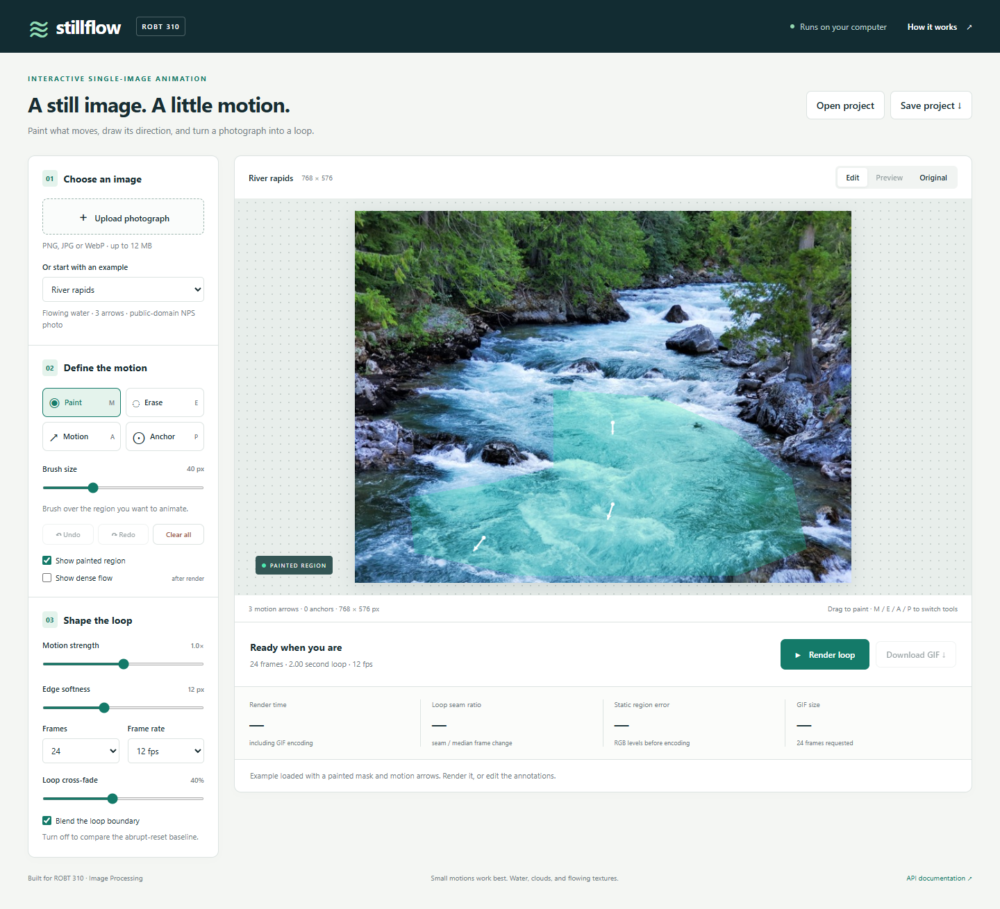
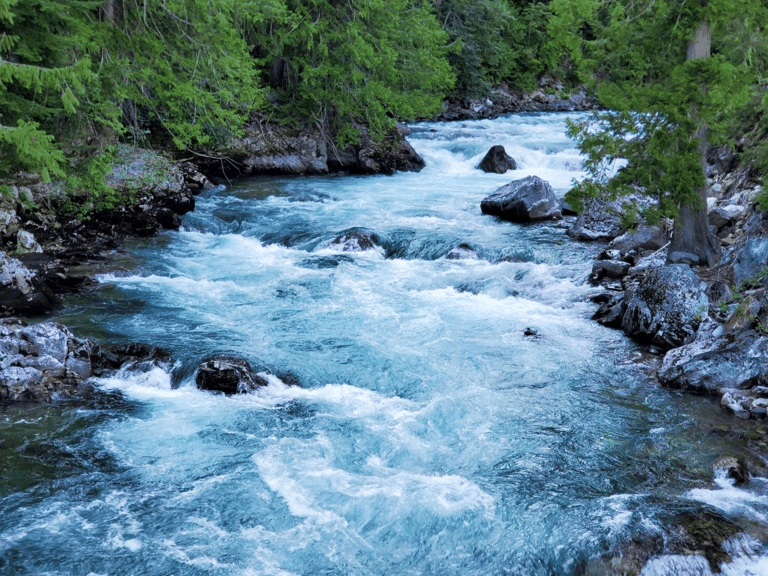
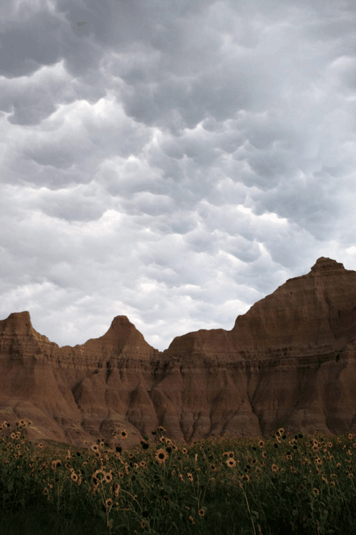
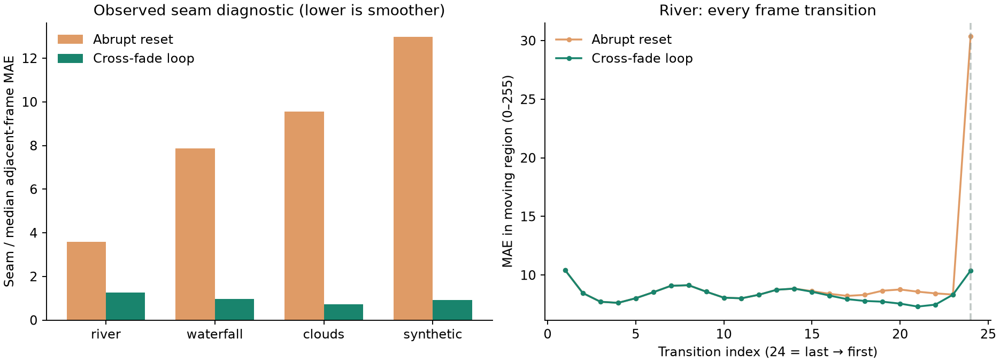

# Stillflow — interactive single-image animation

**ROBT310 Image Processing · Nazarbayev University · Group 2**

Sayat Mushkin · Yerassyl Myngtay · Amir Ussembayev

Paint a region, draw motion arrows, preview a loop, and export an animated GIF. The dense flow field, inverse warp, bilinear sampler, mask feathering, and temporal blending are implemented directly in NumPy. No trained model, GPU, optical-flow library, OpenCV remap, or reference video is needed.



## Start here

**Windows:** install Python 3.11 or newer, then double-click **`start.bat`**. Open **http://127.0.0.1:8000**. First launch installs dependencies; subsequent launches reuse the environment. Python 3.11 is the tested version.

**macOS / Linux:** run `sh start.sh`, then open the same address.

Or use the terminal:

```bash
git clone https://github.com/Capta7nBlack/robt310-stillflow.git
cd robt310-stillflow
python -m venv .venv
# Windows PowerShell:
.venv\Scripts\Activate.ps1
# macOS / Linux instead: source .venv/bin/activate
python -m pip install -r requirements.txt -c constraints.txt
python -m stillflow serve
```

If PowerShell blocks activation, run `.venv\Scripts\python.exe -m stillflow serve` directly. For a different port, use `python -m stillflow serve --port 8001`.

The application is a local Python server with a browser interface. **GitHub hosts the source and results; GitHub Pages cannot run the NumPy backend.** Internet is needed for initial installation, then the editor and bundled examples work offline. Imported photographs stay in the local process and browser. The server does not save uploads.

## A two-minute demonstration

1. The **River rapids** preset loads with a mask and three short arrows. Click **Render loop**.
2. Switch between **Preview**, **Original**, and **Edit**. Turn on **Show dense flow** after rendering.
3. Use **Paint (M)** or **Erase (E)** to change the region. Drag a **Motion (A)** arrow. Click **Anchor (P)** to add a soft zero-motion constraint. Undo/redo is available.
4. Adjust motion strength, edge softness, frames, frame rate, and cross-fade. Re-render after edits.
5. Turn off **Blend the loop boundary**, re-render, and observe the abrupt-reset baseline and seam diagnostic.
6. **Download GIF** exports the actual generated animation. **Save project** embeds the source image, mask, arrows, and settings in a JSON file; **Open project** restores them.

Short, coherent arrows on flowing textures work best. Anchors are soft constraints; erase the mask to keep a region exactly stationary. A long arrow means larger displacement per cycle, not a measured physical velocity.

## Demonstrated outputs

| River rapids | Cloud drift |
|---|---|
|  |  |

Additional outputs include [waterfall](results/gifs/waterfall_full.gif), [procedural diagnostic](results/gifs/synthetic_full.gif), and [abrupt-reset river baseline](results/gifs/river_no_blend.gif). Source credits and licensing are in [examples/sources.json](examples/sources.json). These are **external public-domain photographs**, with project-created annotations; the procedural texture is original generated test data. They are not student-captured photographs.

<!-- MEASURED_RESULTS_START -->
| Case | Full render + encoding | Reset seam ratio | Blended seam ratio | Static max error |
|---|---:|---:|---:|---:|
| River | 4.41 s | 3.59 | 1.26 | 0 |
| Waterfall | 4.87 s | 7.88 | 0.96 | 0 |
| Clouds | 4.01 s | 9.55 | 0.72 | 0 |
| Synthetic | 2.40 s | 12.97 | 0.91 | 0 |

**42 numerical/API tests pass.** Measurements below use the bundled 24-frame recipes. Full machine details and per-transition values are in [results/metrics.json](results/metrics.json).
<!-- MEASURED_RESULTS_END -->



The seam ratio is last-to-first mean absolute difference divided by the median adjacent-frame difference, measured inside the painted region. It is a continuity diagnostic, **not a realism or perceptual-quality score**. A stationary sequence has an undefined ratio. Static error is checked before GIF quantization; shared-palette encoding also preserves static consistency between GIF frames.

## Processing pipeline

```text
Photograph + painted mask + arrows / soft anchors
        ↓
Regularized inverse-distance weighting → dense displacement field
        ↓
Backward mapping → explicit four-neighbor bilinear sampling
        ↓
Two temporal phases + smoothstep cross-fade + inward mask feathering
        ↓
RGB frames → shared-palette GIF → browser preview / download
```

Read [docs/METHOD.md](docs/METHOD.md) for equations, implementation choices, complexity, references, and differences from the interim design. The central numerical implementation is [stillflow/engine.py](stillflow/engine.py); UI and encoding do not hide any ready-made warping routine.

The original proposal was **satellite image upscaling**. The interim report and this implementation instead address **single-image animation**. The current scope offers three inspectable classical image-processing algorithms, direct user control, and tractable CPU evaluation. The historical reason and approval status of the earlier topic change have not been supplied and should be explained by the team, not inferred from the code.

## Reproduce the work

```bash
python -m pip install -r requirements-dev.txt -c constraints.txt
python -m pytest -q --junitxml=outputs/test-report.xml
python scripts/prepare_examples.py
python scripts/evaluate.py
python scripts/build_presentation.py
```

`prepare_examples.py` rebuilds the annotations and original procedural scene without downloading anything. `evaluate.py` renders four cases under four conditions (full method, no temporal blend, no feathering, doubled motion), creates figures, and measures CPU runtime and sampled process memory at 256/512/768 maximum side lengths. Results are single-run observations on the recorded machine, not hardware-independent performance promises.

To render without the browser:

```bash
python -m stillflow render --example examples/river.json --output outputs/river.gif
python -m stillflow render --project my_image.stillflow.json --output outputs/my_image.gif
```

For browser verification, start the server and run `python scripts/browser_check.py`. It uses Playwright with an existing Chrome/Edge installation on Windows; on other systems install its Chromium browser or set `STILLFLOW_BROWSER` to the browser executable. The core/API test suite does not require a browser. CI runs it on every push.

## Files your group should read

| File | Purpose |
|---|---|
| [presentation/progress.pptx](presentation/progress.pptx) | Editable slides with names, real figures, equations, and measured results |
| [presentation/PRESENTER_NOTES.md](presentation/PRESENTER_NOTES.md) | Rehearsal script, live-demo sequence, likely questions, remaining factual inputs |
| [docs/METHOD.md](docs/METHOD.md) | Explain and defend each numerical step |
| [docs/EVALUATION.md](docs/EVALUATION.md) | What was tested, how metrics are computed, and their limits |
| [results/metrics.json](results/metrics.json) | Full measured results and machine information |
| [examples/river.json](examples/river.json) | A reproducible annotation recipe |
| [presentation/team.json](presentation/team.json) | Confirmed names and fields for real contributions / biographies |

## Scope and limitations

- Intended for small water/cloud texture displacements. It does not infer real motion, model physics, reveal occluded surfaces, or animate articulated people.
- Cross-fading can ghost or temporarily soften detail. Clamped sampling can stretch image borders. Mask edges may still show artifacts; feathering cannot reconstruct missing content.
- Uploads are limited to 12 MB / 24 megapixels and reduced to a 768-pixel maximum side. The custom bilinear reduction does not provide full antialiasing for severe downscaling.
- At most 64 controls and 60 frames per request. One render runs at a time. GIF has 256 colors and 10 ms timing units; timing is distributed to preserve total duration. Identical GIF frames may be merged by the encoder.
- Dense flow costs O(HWK), frame generation O(NHW). Frames are retained for GIF encoding, so total memory is O(NHW), not just O(HW).
- No user study, physical ground truth, or student-captured photo set is claimed. Add your own photographs through the upload workflow before presenting if available.

The prototype and documentation were developed with AI coding assistance. Team members should inspect, run, and understand the code and report their actual contributions. Commit timestamps describe the actual work; no fabricated week-long history or user-study results are included.

## References and credits

The method is motivated by [Le et al., *Animating Still Natural Images Using Warping*](https://doi.org/10.1145/3511894), but replaces their preserve-curve method with simple regularized IDW. It is not a reproduction of that paper. Numerical background: [Shepard (1968)](https://doi.org/10.1145/800186.810616), [Wolberg, *Digital Image Warping* (1990)](https://www-cs.ccny.cuny.edu/~wolberg/diw.html), and [Heckbert (1989)](https://www2.eecs.berkeley.edu/Pubs/TechRpts/1989/5504.html). See the method document for full citations and relevant textbook sections.

Code: MIT license. Photographs: public-domain NPS sources with individual credits in the source manifest.
